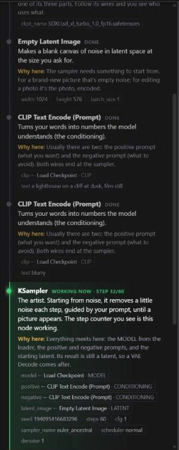

# DPD Studio nodes for ComfyUI

Free tools for people who can't afford the paid ones. These come out of **DPD Studio** (Director Producer Designer), a studio for making films, pictures, sound and websites on one machine. We add a section here each time one is finished.

| Section | What it gives you |
| --- | --- |
| [Comfy Blueprint](#comfy-blueprint) | See where your render is, and learn what every node does and why it's wired there |

More sections are on the way.

## Install

Clone into `ComfyUI/custom_nodes` and restart ComfyUI:

```
cd ComfyUI/custom_nodes
git clone https://github.com/taero2010-cmyk/ComfyUI-DPD-Studio
```

There are no extra Python requirements yet. If a section ever needs some, they'll be listed under that section.

---

## Comfy Blueprint

**ComfyUI shows you the wires. Comfy Blueprint tells you what they mean.**



### The Blueprint tab
A new tab in ComfyUI's left sidebar (the sitemap icon). It lists every node of the open workflow **in the order ComfyUI runs them**, and for each one:

- **What it does**, in plain words: *"The artist. Starting from noise, it removes a little noise each step…"*
- **Why it's here**, meaning why it's wired where it is: *"Everything meets here: the MODEL from the loader, the positive and negative prompts, and the starting latent…"* Nodes without a hand-written note get a "why" read straight from their wires: what they take, from which node, and who they hand their result to.
- **Its wires**: `positive ← CLIP Text Encode · CONDITIONING`
- **Its settings**: seed, steps, cfg, sizes…
- **Skipped nodes**: nodes that won't run, because nothing they feed is saved or shown, are marked as such.

Click any node in the list to jump to it on the canvas.

### Live, while it runs
- **came from**, **now** and **next** stay pinned at the top of the tab
- the node working now **glows green**, with its step counter and a progress line
- finished nodes are ticked, and cached ones count as done
- long jobs that report two counts, such as chunks of a long video and the sampler's steps inside each chunk, show both: `chunk 3/40 · 12/30`

### The Comfy Blueprint node
Add it from **utils → Comfy Blueprint**: a small came from / now / next box for your canvas. Click a step to jump to that node; click anywhere else to open the full Blueprint. It only displays: it's never sent to the server and never changes a render.

### Add notes for more nodes
`web/blueprint/notes.json` holds the plain-words notes, keyed by node class name:

```json
"KSampler": { "what": "What it does.", "why": "Why it's wired where it is." }
```

Pull requests with notes for more nodes are very welcome. That's how this gets better for everyone.

<br clear="right">

## License

MIT. Use these nodes, change them and share them, as long as the license stays with them.
