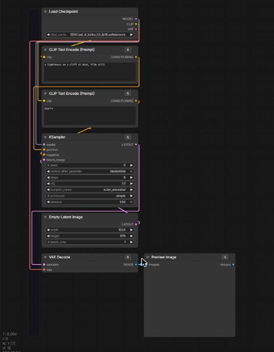

# DPD Studio nodes for ComfyUI

Free tools for people who can't afford the paid ones. These come out of **DPD Studio** (Director Producer Designer), a studio for making films, pictures, sound and websites on one machine. We add a section here each time one is finished.

| Section | What it gives you |
| --- | --- |
| [Comfy Blueprint](#comfy-blueprint) | See where your render is, and learn what every node does and why it's wired there |
| [Comfy Conduit](#comfy-conduit) | Magnets, stacks and passthrough lanes: build a workflow by snapping nodes together, with no long wires |

More sections are on the way.

## Install

Clone into `ComfyUI/custom_nodes` and restart ComfyUI:

```
cd ComfyUI/custom_nodes
git clone https://github.com/taero2010-cmyk/ComfyUI-DPD-Studio
```

There are no extra Python requirements yet. If a section ever needs some, they'll be listed under that section.

---

## Comfy Blueprint

**ComfyUI shows you the wires. Comfy Blueprint tells you what they mean.**


### The Blueprint tab
A new tab in ComfyUI's left sidebar (the sitemap icon). It lists every node of the open workflow **in the order ComfyUI runs them**, and for each one:

- **What it does**, in plain words: *"The artist. Starting from noise, it removes a little noise each step…"*
- **Why it's here**, meaning why it's wired where it is: *"Everything meets here: the MODEL from the loader, the positive and negative prompts, and the starting latent…"* Nodes without a hand-written note get a "why" read straight from their wires: what they take, from which node, and who they hand their result to.
- **Its wires**: `positive ← CLIP Text Encode · CONDITIONING`
- **Its settings**: seed, steps, cfg, sizes…
- **Skipped nodes**: nodes that won't run, because nothing they feed is saved or shown, are marked as such.

Click any node in the list to jump to it on the canvas.

### Live, while it runs
- **came from**, **now** and **next** stay pinned at the top of the tab
- the node working now **glows green**, with its step counter and a progress line
- finished nodes are ticked, and cached ones count as done
- long jobs that report two counts, such as chunks of a long video and the sampler's steps inside each chunk, show both: `chunk 3/40 · 12/30`

### The Comfy Blueprint node
Add it from **utils → Comfy Blueprint**: a small came from / now / next box for your canvas. Click a step to jump to that node; click anywhere else to open the full Blueprint. It only displays: it's never sent to the server and never changes a render.

### Add notes for more nodes
`web/blueprint/notes.json` holds the plain-words notes, keyed by node class name:

```json
"KSampler": { "what": "What it does.", "why": "Why it's wired where it is." }
```

Pull requests with notes for more nodes are very welcome. That's how this gets better for everyone.

<br clear="right">

---

## Comfy Conduit

**Snap nodes together like magnets. Long wires ride lanes instead of crossing your canvas.**



### Magnets
Drag a node near another. If they can connect, the edge lights up green and a label shows exactly what will wire up (`CLIP → clip`, `VAE → vae (lane)`). Let go and the node snaps alongside and wires itself. If nothing fits, nothing snaps.

Snapping wires to the **whole stack**, not just the node you dropped next to. A VAE Decode dropped at the bottom gets its VAE from the Load Checkpoint at the top. Members are read top to bottom, so a prompt stacked above another lands on *positive* and the lower one on *negative*.

Alt-drag is still ComfyUI's own copy-and-drag; the copy starts outside any stack.

### Stacks
Snapped nodes become one stack and move together: drag any member and the whole stack follows. To take a node out, **right-click it → Take out of stack** (or use the button in its ⇅ picker). **Take the whole stack apart** is in the same menu.

### Line up
The thing everyone does by hand before showing a workflow, done for you. Every time a node snaps into a stack, the stack lines up: each column gets one width, the widest node's (never narrower than a node needs), and every gap becomes the same. Nodes beside the column line their tops up with the node they sit next to.

It works on any nodes, not only stacks: select a few, right-click one and choose **Line up the selected nodes**. A stack also has **Line up this stack** in its right-click menu. Turn off the automatic line-up under **Settings → Comfy Blueprint → Conduit → Line up**.

### Passthrough lanes
A wire between two members of a stack, with others in between, or one that climbs back up the stack, is drawn through the stack's lane channel instead of looping across the canvas. Each lane has its own track, so many can run side by side.

The wire itself is an ordinary ComfyUI link. Renders are exactly the same, and a workflow opened without this pack just shows normal wires.

### The lane picker
The **⇅** badge on a node's title opens a list of everything that node can take and every node on the canvas that can feed it, nearest first: *"vae needs a VAE: from Load Checkpoint · 5 boxes up, through the lanes"*. Pick one and it's wired.

Every node has the badge, including ones that only *give*, like Load Upscale Model. When nothing on the canvas can use what a node makes (or make what it needs), the picker names its **partner**, with a note on what that partner does: *"Nothing on the canvas can use an UPSCALE_MODEL yet. Its partner: ＋ Add Upscale Image (using Model)"*. One click adds the partner to the stack, wired, and it picks up anything else it needs from the stack.

Turn it all off under **Settings → Comfy Blueprint → Conduit**.

<br clear="right">

## License

MIT. Use these nodes, change them and share them, as long as the license stays with them.
